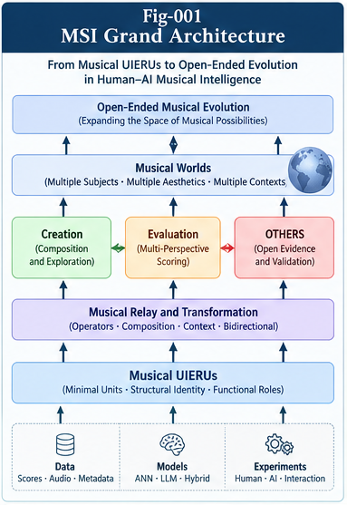
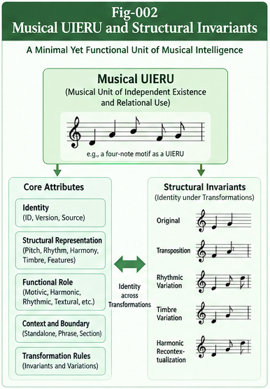
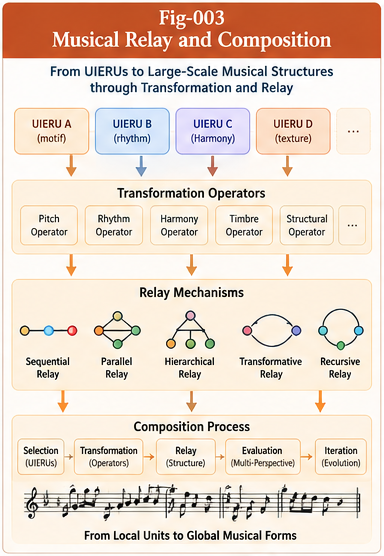
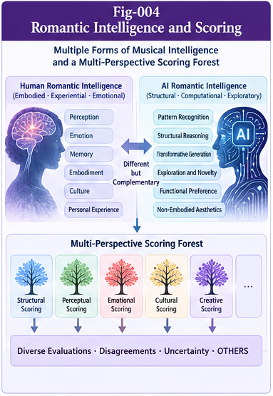
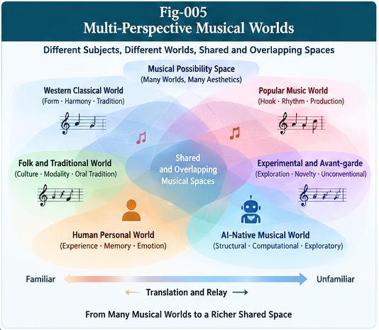
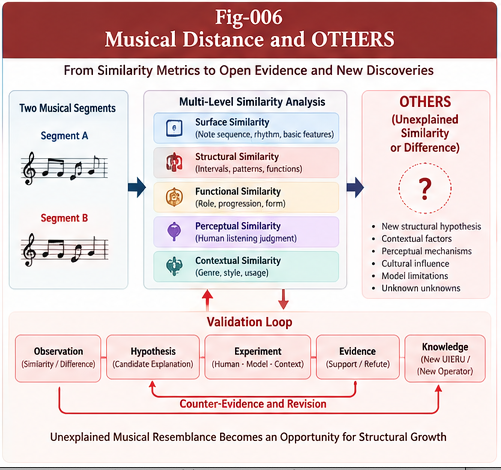
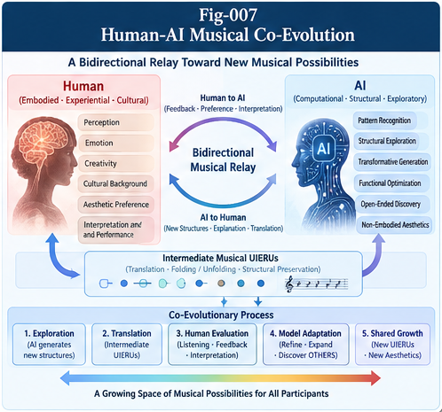

# Figure Index — Musical Structural Intelligence and Open-Ended Evolution

**Project:** Musical Structural Intelligence and Open-Ended Evolution (MSI-OEE)  
**Version:** 1.0.0  
**Authors:** Sizhe Tan & GPT-Obot  
**Status:** Conceptual research framework; figures are explanatory schematics, not empirical results.

## Purpose

This index identifies the seven figures for MSI-OEE, describes their conceptual role, and provides consistent placement and Markdown embedding guidance. The illustrations should be interpreted as **proposed architectures and research hypotheses**, not as demonstrations of validated musical intelligence or AI subjective experience.

> **Asset integrity note:** The filenames below are the canonical target names in the repository's `figures/` directory. Confirm that each image is actually exported as a separate PNG with the corresponding filename before using these links. A single seven-panel collage does not by itself create seven separate image files.

## Figure Inventory

| ID | Canonical file | Main subject | Primary document | Additional placement |
|---|---|---|---|---|
| Fig-001 | `Fig-001-MSI-Grand-Architecture.png` | MSI-OEE research landscape and its structural feedback loops | `README.md`, `docs/MSI-001-From-Music-to-Musical-Structural-Intelligence.md` | `START-HERE.md` (optional) |
| Fig-002 | `Fig-002-Musical-UIERU-and-Structural-Invariants.png` | Musical units, contextual boundaries, transformation invariants | `docs/MSI-002-Musical-UIERUs-Boundaries-and-Invariants.md` | `cases/CASE-001-Motif-Transformation-and-Identity.md` |
| Fig-003 | `Fig-003-Musical-Relay-and-Composition.png` | Relay operators, soft contracts, compositional graphs | `docs/MSI-003-Structural-Relay-and-Musical-Composition.md` | `specs/SPEC-002-Transformation-and-Relay-Operators.md` |
| Fig-004 | `Fig-004-Romantic-Intelligence-and-Scoring.png` | Precision, creative deviation, expressive valuation | `docs/MSI-004-Romantic-Intelligence-and-Creative-Deviation.md` | `docs/MSI-007-AI-Musical-Creation-and-Structural-Evolution.md` |
| Fig-005 | `Fig-005-Multi-Perspective-Musical-Worlds.png` | Composer, performer, listener, and cultural scoring perspectives | `docs/MSI-005-Perspective-Scoring-and-Musical-Worldviews.md` | `specs/SPEC-003-Perspective-Scoring-Schema.md` |
| Fig-006 | `Fig-006-Musical-Distance-and-OTHERS.png` | Similarity, unexplained residuals, counter-evidence, and validation | `docs/MSI-006-Musical-Distance-OTHERS-and-Open-Evidence.md` | `cases/CASE-002-Musical-Similarity-and-OTHERS.md`, `specs/SPEC-004-OTHERS-Evidence-and-Validation.md` |
| Fig-007 | `Fig-007-Human-AI-Musical-Co-Evolution.png` | Human-native/AI-native perspectives and bidirectional translation | `docs/MSI-008-Human-AI-Musical-Co-Evolution.md` | `docs/MSI-007-AI-Musical-Creation-and-Structural-Evolution.md`, `cases/CASE-003-Human-AI-Musical-Translation.md` |

## Detailed Figure Descriptions and Placement Guidance

### Fig-001 — MSI Grand Architecture

**File:** `figures/Fig-001-MSI-Grand-Architecture.png`

**Concept:** An overview connecting musical perception and representation to Musical UIERUs, structural relay, perspective-aware scoring, OTHERS-based evidence discovery, and open-ended growth. Arrows should distinguish candidate generation, evaluation, counter-evidence, and validated knowledge promotion.

**Recommended placement:** In `README.md`, immediately after the introductory project thesis and before the research pillars. In `MSI-001`, place after the initial argument for music as a structural intelligence research domain.

**Suggested caption:** *Figure 1. Proposed MSI-OEE architecture: musical structures become candidates for reusable units, relay operations, perspective-conditioned evaluation, and evidence-governed structural growth.*

**Embed from repository root:**

```markdown

```

**Embed from `docs/`:**

```markdown

```

### Fig-002 — Musical UIERU and Structural Invariants

**File:** `figures/Fig-002-Musical-UIERU-and-Structural-Invariants.png`

**Concept:** Candidate motifs or phrases are represented with structural features, boundaries, contexts, and identity tests. Transformations such as transposition, rhythmic variation, re-orchestration, and reharmonization illustrate that surface equality, structural identity, and functional identity are different judgments.

**Recommended placement:** In `MSI-002`, after defining the candidate Musical UIERU contract and before the discussion of transformation-dependent identity. Reuse in `CASE-001` near its transformation matrix.

**Suggested caption:** *Figure 2. Musical UIERU candidates and the contextual tests used to investigate structural and functional identity under transformation.*

**Embed from `docs/` or `cases/`:**

```markdown

```

### Fig-003 — Musical Relay and Composition

**File:** `figures/Fig-003-Musical-Relay-and-Composition.png`

**Concept:** Musical units can be sequenced, layered, transformed, nested, recursively developed, and interpreted across contexts. Relay edges should carry declared constraints, preserved properties, and intended creative deviations rather than imply unconditional compatibility.

**Recommended placement:** In `MSI-003`, after introducing the taxonomy of relay operators. Reuse in `SPEC-002` beside operator inputs, outputs, and soft-contract conditions.

**Suggested caption:** *Figure 3. A proposed musical relay graph linking reusable units through composition and transformation operators with explicit constraints and provenance.*

**Embed:**

```markdown

```

### Fig-004 — Romantic Intelligence and Scoring

**File:** `figures/Fig-004-Romantic-Intelligence-and-Scoring.png`

**Concept:** A precision-oriented evaluation plane interacts with an expressive or exploratory plane. Deviations are neither automatically errors nor automatically valuable; their expressive significance depends on context, listener perspective, and evidence. Candidate new scoring criteria may emerge from repeated, independently tested observations.

**Recommended placement:** In `MSI-004`, immediately after the formal distinction between random error, deliberate deviation, and meaningful expressive freedom.

**Suggested caption:** *Figure 4. Romantic Intelligence as a research hypothesis: controlled deviation and perspective-dependent scoring may reveal expressive value beyond existing optimization criteria.*

**Embed:**

```markdown

```

### Fig-005 — Multi-Perspective Musical Worlds

**File:** `figures/Fig-005-Multi-Perspective-Musical-Worlds.png`

**Concept:** The composer, performer, listener, and cultural community interact with a shared musical artifact but may have different world models, objectives, memories, and evaluative authority. The design should preserve disagreement and uncertainty rather than collapse all perspectives into one universal score.

**Recommended placement:** In `MSI-005`, following the introduction of the four musical perspectives. Reuse in `SPEC-003` when presenting subject/context/score/provenance fields.

**Suggested caption:** *Figure 5. Multiple musical perspectives evaluate and reinterpret shared structures while retaining distinct scoring contexts and authority.*

**Embed:**

```markdown

```

### Fig-006 — Musical Distance and OTHERS

**File:** `figures/Fig-006-Musical-Distance-and-OTHERS.png`

**Concept:** Feature-level and transformation-aware comparisons are combined with contextual evidence and human judgments. Unexplained agreement or disagreement enters an OTHERS register, followed by hypothesis formation, counter-evidence, independent validation, and possible promotion to a new structural feature. Similarity alone must not be depicted as a legal finding of plagiarism.

**Recommended placement:** In `MSI-006`, after introducing the open-evidence comparison model. Reuse in `CASE-002` near the comparison protocol and in `SPEC-004` near the validation lifecycle.

**Suggested caption:** *Figure 6. Musical similarity as an open-evidence process: residual disagreement motivates testable hypotheses and counter-evidence rather than unsupported conclusions.*

**Embed:**

```markdown

```

### Fig-007 — Human–AI Musical Co-Evolution

**File:** `figures/Fig-007-Human-AI-Musical-Co-Evolution.png`

**Concept:** Human-native musical experience and AI-native computational evaluation are distinct but potentially interoperable. Intermediate Musical UIERUs, representation conversion, folding/unfolding, and bidirectional feedback create an experimental shared exploration space. AI functional preferences should not be portrayed as proof of subjective feeling.

**Recommended placement:** In `MSI-008`, after introducing bidirectional musical relay and cross-subject aesthetic translation. Reuse in `MSI-007` near the discussion of AI-native exploration, and in `CASE-003` near the progressive translation protocol.

**Suggested caption:** *Figure 7. A proposed human–AI musical co-evolution loop using intermediate structures, bidirectional relay, and independent perspective-aware evaluation.*

**Embed:**

```markdown

```

## Cross-Reference and Editorial Rules

1. **Canonical names:** Keep the `Fig-001` through `Fig-007` identifiers and exact filenames unchanged across the repository.
2. **Relative links:** Use `figures/...` from root-level Markdown files and `figures/...` from `docs/`, `cases/`, or `specs/`.
3. **One source of truth:** Store each illustration once under `figures/`; reference the same file wherever it is reused.
4. **Caption discipline:** Identify every figure as conceptual or proposed unless empirical validation is actually reported.
5. **Readability:** Use descriptive alt text; avoid tiny labels and unexplained acronyms in final exported artwork.
6. **Claims and provenance:** Do not present speculative AI subjective experience, legal infringement determinations, or autonomous open-ended evolution as established results.
7. **Release check:** Verify that all seven PNG files exist independently, load correctly on GitHub, and match their captions before creating the release tag.

## Release Verification Checklist

- [ ] All seven canonical PNG files are present under `figures/`.
- [ ] Every image matches its corresponding title and conceptual content.
- [ ] `README.md` includes Fig-001 with a working root-relative path.
- [ ] MSI-001 through MSI-008 include their intended figure references.
- [ ] CASE and SPEC references use valid parent-relative paths.
- [ ] No image references point to a composite collage in place of an individual figure.
- [ ] Captions and terminology match `GLOSSARY.md` and the research claims in the relevant documents.
- [ ] Images render correctly in GitHub's Markdown preview.

---

**MSI-OEE v1.0.0**  
*Musical Structural Intelligence and Open-Ended Evolution*  
**Sizhe Tan & GPT-Obot**
