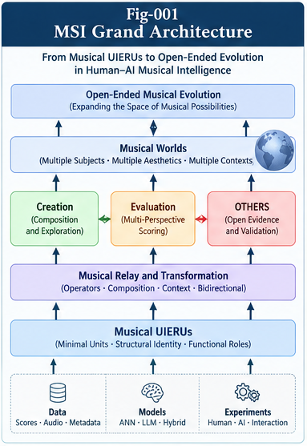

# Musical Structural Intelligence and Open-Ended Evolution (MSI-OEE)

**From Musical UIERUs and Romantic Intelligence to Perspective Scoring, Structural Relay, and Human–AI Co-Evolution**

**Authors:** Sizhe Tan & GPT-Obot  
**Release:** v1.0.0  
**Status:** Conceptual research framework, proposed specifications, case-study designs, and validation roadmap

> **Central question:** Can music serve as a rigorous testbed for structural intelligence—revealing how reusable units, transformations, subjective evaluation, creative deviation, and cross-subject relay contribute to open-ended discovery?

## Overview

Music combines remarkable structural regularity with expressive freedom. Motifs recur without remaining identical; performances communicate through timing and timbre; listeners disagree about value; and musical cultures continually revise what counts as compelling or meaningful. These features make music a challenging and potentially illuminating domain for studying **Structural Intelligence (SI)**.

MSI-OEE explores music through the proposed lens of **Universal Intelligence Evolution and Relay Units (UIERUs)**: context-sensitive, reusable structures that may support identification, transformation, composition, evaluation, and cumulative learning. A *Musical UIERU* is a **research candidate**, not a claim that every musical fragment is an intelligence unit. The project asks which units can be defined operationally, which properties survive transformation, and which purported structures withstand controlled testing.

The framework connects six lines of inquiry:

1. **Musical UIERUs:** candidate units, functional roles, dynamic boundaries, and structural invariants.
2. **Structural Relay:** sequential, parallel, hierarchical, transformative, recursive, and cross-subject composition.
3. **Romantic Intelligence:** meaningful deviation, expressive freedom, and discovery of value not yet represented by existing scoring rules.
4. **Perspective Scoring:** the different evaluations of composers, performers, listeners, cultures, and AI systems.
5. **Musical Distance and OTHERS:** similarity, unexplained residuals, counter-evidence, and evidence-driven structural growth.
6. **Human–AI Musical Co-Evolution:** embodied human experience, AI-native structural exploration, translation, and bidirectional learning.

*Figure 1. Proposed relationships among musical units, relay, evaluation, open evidence, and evolving musical worlds.*

## Why Music?

Music offers several unusually demanding tests for an intelligence architecture:

- **Identity without exact equality.** A motif may remain recognizable after transposition or changes in rhythm, harmony, instrumentation, and performance.
- **Context-dependent boundaries.** A fragment can function differently as an isolated gesture, part of a phrase, or an element in a larger composition.
- **Non-additive value.** The value of a passage may depend on anticipation, contrast, resolution, memory, and its position within a whole.
- **Multiple evaluators.** Composer intent, performer interpretation, listener response, and cultural practice need not agree.
- **Creative departures from precision.** Timing variation or harmonic surprise can be expressive rather than erroneous.
- **Historical evolution.** Musical forms, conventions, and standards of evaluation change over time.

These characteristics make music more than an application of existing SI concepts: it may expose limits in the concepts themselves and motivate revisions to them.

## Research Architecture

### 1. Musical UIERUs and identity

Candidate units include motifs, phrases, rhythmic patterns, harmonic movements, timbral gestures, and higher-order structural relations. The project distinguishes **surface equality**, **structural identity**, and **functional identity**. Claims of invariance must identify the transformation family, context, perspective, and supporting evidence.

Read: [MSI-002](docs/MSI-002-Musical-UIERUs-Boundaries-and-Invariants.md) · [SPEC-001](specs/SPEC-001-Musical-UIERU-Contract.md)

### 2. Composition as structural relay

Composition is investigated as more than concatenation. Relay operators transform and coordinate units through timing, hierarchy, interaction, contextual interpretation, and feedback. **Soft contracts** allow purposeful departures from constraints while retaining an auditable account of what changed.

Read: [MSI-003](docs/MSI-003-Structural-Relay-and-Musical-Composition.md) · [SPEC-002](specs/SPEC-002-Transformation-and-Relay-Operators.md)

### 3. Romantic Intelligence and creative deviation

**Romantic Intelligence** is proposed as a working term for the ability to explore, generate, and assess contextually meaningful deviations that may disclose previously unrecognized value. It is **not** a synonym for randomness, technical inaccuracy, human emotion, or established scientific consensus. The proposed construct requires explicit operational definitions and falsifiable comparisons.

Read: [MSI-004](docs/MSI-004-Romantic-Intelligence-and-Creative-Deviation.md)

### 4. Perspective-aware musical valuation

Musical evaluation is represented as a **Perspective-Conditioned Scoring Forest**, not necessarily a universal scalar score. Human and AI evaluations may differ; those differences are observations to explain, not errors to erase. **Scoring sovereignty** identifies who is entitled to define or revise a particular evaluation objective.

Read: [MSI-005](docs/MSI-005-Perspective-Scoring-and-Musical-Worldviews.md) · [SPEC-003](specs/SPEC-003-Perspective-Scoring-Schema.md)

### 5. Musical distance, OTHERS, and open evidence

A useful similarity model may need to distinguish surface resemblance, transformation-aware structural correspondence, musical function, human perception, and provenance. **OTHERS** names an open evidence space for unexplained effects; it is not permission to assign arbitrary similarity scores. Disagreements generate hypotheses, which must face baselines, independent validation, and counter-evidence before becoming reusable knowledge.

**Musical similarity, evidence of copying, and legal copyright infringement are distinct questions.** This project does not propose automated legal determinations.

Read: [MSI-006](docs/MSI-006-Musical-Distance-OTHERS-and-Open-Evidence.md) · [SPEC-004](specs/SPEC-004-OTHERS-Evidence-and-Validation.md)

### 6. AI musical creation and human–AI co-evolution

The framework distinguishes high-throughput generation from structural composition, validated structural innovation, and genuinely open-ended evolution. It also separates **functional AI preferences** from unproven claims about AI subjective enjoyment. Human musical experience is embodied, historical, and cultural; AI systems may explore different structural possibilities without replicating that experience.

A proposed **bidirectional musical relay** uses intermediate Musical UIERUs and translation operators to make unfamiliar structures accessible while allowing human feedback to revise AI models. The objective is not to collapse human and AI perspectives into one score, but to explore how each may learn from the other.

Read: [MSI-007](docs/MSI-007-AI-Musical-Creation-and-Structural-Evolution.md) · [MSI-008](docs/MSI-008-Human-AI-Musical-Co-Evolution.md)

## Core Publications

| ID | Research paper |
|---|---|
| MSI-001 | [From Music to Musical Structural Intelligence](docs/MSI-001-From-Music-to-Musical-Structural-Intelligence.md) |
| MSI-002 | [Musical UIERUs, Boundaries, and Invariants](docs/MSI-002-Musical-UIERUs-Boundaries-and-Invariants.md) |
| MSI-003 | [Structural Relay and Musical Composition](docs/MSI-003-Structural-Relay-and-Musical-Composition.md) |
| MSI-004 | [Romantic Intelligence and Creative Deviation](docs/MSI-004-Romantic-Intelligence-and-Creative-Deviation.md) |
| MSI-005 | [Perspective Scoring and Musical Worldviews](docs/MSI-005-Perspective-Scoring-and-Musical-Worldviews.md) |
| MSI-006 | [Musical Distance, OTHERS, and Open Evidence](docs/MSI-006-Musical-Distance-OTHERS-and-Open-Evidence.md) |
| MSI-007 | [AI Musical Creation and Structural Evolution](docs/MSI-007-AI-Musical-Creation-and-Structural-Evolution.md) |
| MSI-008 | [Human–AI Musical Co-Evolution](docs/MSI-008-Human-AI-Musical-Co-Evolution.md) |

## Cases and Research Contracts

**Research cases** provide controlled examples and experimental designs, not claims of completed empirical validation:

- [CASE-001 — Motif Transformation and Identity](cases/CASE-001-Motif-Transformation-and-Identity.md)
- [CASE-002 — Musical Similarity and OTHERS](cases/CASE-002-Musical-Similarity-and-OTHERS.md)
- [CASE-003 — Human–AI Musical Translation](cases/CASE-003-Human-AI-Musical-Translation.md)

**Proposed specifications** define interfaces for future implementation and testing:

- [SPEC-001 — Musical UIERU Contract](specs/SPEC-001-Musical-UIERU-Contract.md)
- [SPEC-002 — Transformation and Relay Operators](specs/SPEC-002-Transformation-and-Relay-Operators.md)
- [SPEC-003 — Perspective Scoring Schema](specs/SPEC-003-Perspective-Scoring-Schema.md)
- [SPEC-004 — OTHERS Evidence and Validation](specs/SPEC-004-OTHERS-Evidence-and-Validation.md)

## Research Questions and Validation

The first validation priority is to determine whether explicit Musical UIERU representations offer **measurable benefits over matched baselines**, rather than merely providing appealing descriptions. Representative tests include:

- **Identity:** Can a model predict human judgments of motif identity across controlled transformations, contexts, and listener groups?
- **Composition:** Do relay-aware systems improve long-range coherence or controlled variation compared with matched generative baselines?
- **Creative deviation:** Can proposed Romantic Intelligence mechanisms produce independently preferred or more expressive outputs, beyond random perturbations and conventional optimization?
- **Perspective:** Do subject- and context-conditioned models predict held-out evaluations better than a single pooled score?
- **Open evidence:** Does a validated OTHERS-derived feature improve out-of-sample prediction without inflating false positives?
- **Translation:** Do intermediate structures improve human comprehension of unfamiliar music while preserving declared structural relations?
- **Evolution:** Do newly discovered units or operators transfer to unseen tasks and remain useful under independent evaluation?

Studies should predefine metrics, include negative controls and ablations, record evaluator disagreement, separate discovery and test data, and retain counter-evidence. Where human listening studies are involved, recruitment, consent, accessibility, and cultural diversity should be addressed.

See [TESTABLE-HYPOTHESES.md](TESTABLE-HYPOTHESES.md), [VALIDATION-ROADMAP.md](VALIDATION-ROADMAP.md), and [OPEN-QUESTIONS.md](OPEN-QUESTIONS.md).

## Seven-Figure Visual Guide

| Figure | Subject |
|---|---|
| [Fig-001](figures/Fig-001-MSI-Grand-Architecture.png) | MSI grand architecture |
| [Fig-002](figures/Fig-002-Musical-UIERU-and-Structural-Invariants.png) | Musical units and identity-preserving transformations |
| [Fig-003](figures/Fig-003-Musical-Relay-and-Composition.png) | Relay operators and composition |
| [Fig-004](figures/Fig-004-Romantic-Intelligence-and-Scoring.png) | Creative deviation and perspective scoring |
| [Fig-005](figures/Fig-005-Multi-Perspective-Musical-Worlds.png) | Human, cultural, and AI musical worlds |
| [Fig-006](figures/Fig-006-Musical-Distance-and-OTHERS.png) | Similarity, residual evidence, and validation |
| [Fig-007](figures/Fig-007-Human-AI-Musical-Co-Evolution.png) | Bidirectional relay and shared exploration |

For descriptions and insertion guidance, see [FIGURE-INDEX.md](FIGURE-INDEX.md).

## Connections to the Structural Intelligence Research Program

MSI-OEE is designed to exchange concepts and candidate findings with related SI frameworks:

| Framework | Contribution to MSI-OEE | Potential return relay |
|---|---|---|
| UIERU | Reusable units, relay, evolution | Dynamic unit boundaries and soft contracts |
| SIF | Localization, per-node intelligence, contracts, validation | Domain-specific structural tests |
| UCPSF | Scoring forests and control planes | Perspective-conditioned aesthetic evaluation |
| SSI | Subject boundaries and scoring sovereignty | Cross-subject musical translation |
| BM-ODWEI | Distance, OTHERS, open evidence | Auditable residual-feature discovery |
| Structural RSI | Recursive improvement and evaluator governance | Validated musical structure growth |
| Structural Folding / Unfolding | Transformation and representation changes | Human-accessible rendering of unfamiliar structures |

**Relay principle:** SI frameworks → musical hypotheses and experiments → independently validated findings → *candidate* SI extensions. Findings do not become universal principles merely because they appear in music.

## Reading Paths

- **New readers:** [START-HERE.md](START-HERE.md) → MSI-001 → MSI-002 → MSI-004 → MSI-008.
- **Structural architecture:** MSI-002 → MSI-003 → SPEC-001 → SPEC-002 → CASE-001.
- **Scoring and evidence:** MSI-005 → MSI-006 → SPEC-003 → SPEC-004 → CASE-002.
- **AI and co-evolution:** MSI-007 → MSI-008 → CASE-003 → [FUTURE-DIRECTIONS.md](FUTURE-DIRECTIONS.md).
- **Experimental researchers:** [TESTABLE-HYPOTHESES.md](TESTABLE-HYPOTHESES.md) → [VALIDATION-ROADMAP.md](VALIDATION-ROADMAP.md) → relevant cases and specs.

Full navigation: [CONTENTS.md](CONTENTS.md) · Terminology: [GLOSSARY.md](GLOSSARY.md).

## Scope, Limitations, and Responsible Claims

This **v1.0.0 research release** proposes concepts, architectures, case designs, and validation procedures. Unless accompanied by independently documented results, it **does not establish**:

- that Musical UIERUs exist as universal natural units;
- that Romantic Intelligence is a validated scientific construct;
- that AI has subjective musical feelings or consciousness;
- that an AI system has achieved autonomous musical greatness;
- that musical structural evolution is already open-ended in practice;
- that similarity scores determine plagiarism or legal infringement.

The project favors transparent assumptions, counter-examples, reproducible experiments, and explicit uncertainty. It treats human aesthetic judgments as indispensable evidence in human-oriented music research, while recognizing their diversity and context dependence.

## Citation and Release

**Authors:** Sizhe Tan & GPT-Obot  
**Version:** v1.0.0  
**Repository:** https://github.com/sizhet/Musical-Structural-Intelligence-and-Open-Ended-Evolution

The repository address above is the intended project URL; confirm it matches the published repository before release. DOI metadata should be inserted **only after a DOI is assigned**. Consult [CITATION.cff](CITATION.cff), [.zenodo.json](.zenodo.json), and [CHANGELOG.md](CHANGELOG.md) for release metadata.

For publication context, see [GitHub Release Notes](GitHub-Release-Notes-v1.0.0.md) and [ResearchGate Description](ResearchGate-Description.txt).

---

## Authors

**Sizhe Tan & GPT-Obot**

DOI: 10.5281/zenodo.23852000

---

## 📚 DBM-SI Series Navigation

See:\
[./docs/DBM-SI-Series-of-gitHub-Repositories/DBM-SI-Series-of-gitHub-Repositories.md](./docs/DBM-SI-Series-of-gitHub-Repositories/DBM-SI-Series-of-gitHub-Repositories.md)

---

**MSI-OEE — Musical Structural Intelligence and Open-Ended Evolution**  
*From precision to expression; from structure to Romantic Intelligence; from individual creation to open-ended co-evolution.*
